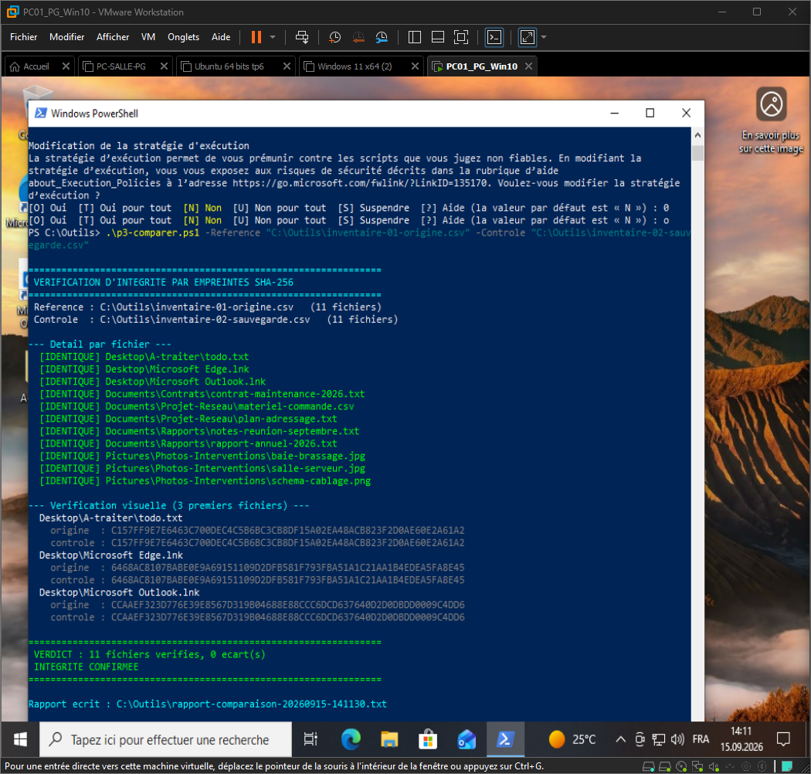
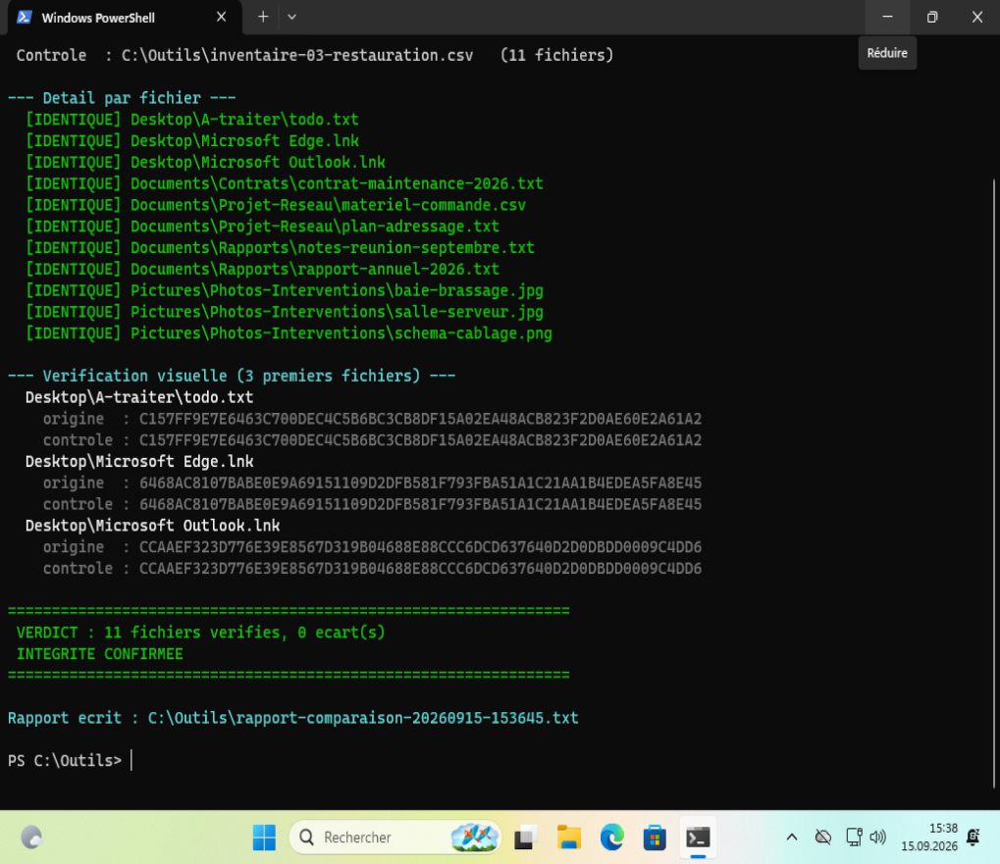

# 💾 Migration de Windows 10 vers Windows 11, avec preuve d'intégrité des données


> **En une phrase :** j'ai migré un poste de Windows 10 vers Windows 11 en sauvegardant les données de l'utilisateur, et j'ai **prouvé** par des empreintes SHA-256 calculées par mes scripts PowerShell que les 11 fichiers restaurés étaient identiques à l'octet près.

Ce dépôt est écrit pour être compris **même sans rien connaître** à la migration de postes : tous les mots techniques sont expliqués.
👉 Le rapport d'intervention complet est dans [`rapport-technique.md`](rapport-technique.md), et le mode opératoire réutilisable dans [`procedure-migration.md`](procedure-migration.md).

> **Projet 3/5** du PPE IT Essentials, module CFC 187 *« Mettre en service un poste de travail ICT avec le système d'exploitation »*, classe E1B, Geneva Institute of Technology (GIT), septembre 2026.

| | |
|---|---|
| **Technicien** | Paul Giocanti |
| **Date** | 15 septembre 2026 |
| **Poste** | `PC01-PG` |

---

## 🎯 Le problème

Un poste sous Windows 10 ne reçoit plus de correctifs de sécurité depuis octobre 2025. Il doit être migré vers Windows 11. L'utilisateur doit retrouver ses fichiers et son environnement.

La difficulté n'est pas la réinstallation — elle est automatisée et prend trente minutes. La difficulté est de **prouver** que les données restaurées sont identiques aux originales. « J'ai regardé, les fichiers sont là » n'est pas une preuve.

## 🧪 La méthode

Une **empreinte SHA-256** est calculée pour chaque fichier à trois moments : avant la sauvegarde, après la copie sur le support, et après la restauration sur le système réinstallé. Un script de comparaison confronte les inventaires et rend un verdict calculé.

```
 VERDICT : 11 fichiers verifies, 0 ecart(s)
 INTEGRITE CONFIRMEE
```

La comparaison décisive oppose l'état **d'avant l'effacement du disque** à l'état **d'après la réinstallation complète**. Entre les deux : quatre partitions supprimées, un système d'exploitation remplacé, un compte utilisateur recréé.

> Comparer les tailles ne suffirait pas : un fichier corrompu pendant une copie conserve presque toujours sa taille. L'empreinte, elle, détecte la modification d'un seul octet.

---

## ✅ Résultats

| Indicateur | Valeur |
|---|---|
| Fichiers migrés | 11 (dont 3 binaires) |
| Volume | 1.35 Mo |
| Écarts d'intégrité après sauvegarde | **0** |
| Écarts d'intégrité après restauration | **0** |
| Tests du plan de test | 16 / 16 conformes |
| Nom de machine | rétabli à l'identique |
| Édition du système | Professionnel → Professionnel |
| Adresse IP | identique (même bail DHCP) |

---

## 📁 Contenu du dépôt

| Fichier | Description |
|---|---|
| **[`rapport-technique.md`](rapport-technique.md)** | Rapport d'intervention complet — méthode, déroulé commenté capture par capture, plan de test, problèmes rencontrés, écarts et recommandations, glossaire |
| **[`procedure-migration.md`](procedure-migration.md)** | **Mode opératoire réutilisable** — document autonome, applicable par un autre technicien sur un autre poste |
| [`scripts/`](scripts/) | Les trois scripts PowerShell de l'intervention |
| [`captures/`](captures/) | Les 20 captures d'écran de preuve |

### Scripts

| Script | Rôle |
|---|---|
| [`p3-inventaire.ps1`](scripts/p3-inventaire.ps1) | Inventorie un profil utilisateur et calcule l'empreinte SHA-256 de chaque fichier → CSV |
| [`p3-comparer.ps1`](scripts/p3-comparer.ps1) | Confronte deux inventaires et rend un verdict d'intégrité + rapport horodaté |
| [`p3-preparer-donnees.ps1`](scripts/p3-preparer-donnees.ps1) | Constitue un jeu de données de test réaliste (utilitaire de mise en situation) |

Les deux premiers sont entièrement paramétrés et ne contiennent aucun chemin en dur :

```powershell
# Inventorier un profil
.\p3-inventaire.ps1 -Racine "$env:USERPROFILE" -Sortie "C:\Outils\inventaire-01-origine.csv"

# Vérifier l'intégrité
.\p3-comparer.ps1 -Reference "C:\Outils\inventaire-01-origine.csv" `
                  -Controle  "C:\Outils\inventaire-03-restauration.csv"
```

`p3-comparer.ps1` renvoie un code de sortie exploitable : `0` si conforme, `1` si un écart est détecté — utilisable dans une chaîne automatisée.

---

## 🔍 Les deux preuves centrales

### Intégrité de la sauvegarde



Onze fichiers `[IDENTIQUE]`, trois paires d'empreintes complètes affichées côte à côte, verdict `INTEGRITE CONFIRMEE`. C'est ce verdict qui autorise l'effacement du disque système.

### Intégrité de la restauration



Même verdict, mais cette fois entre l'inventaire d'origine et les données revenues sur un système entièrement réinstallé.

---

## ⚠️ Points techniques notables

**Le chemin relatif n'est pas un détail.** La lettre du support de sauvegarde est passée de `E:` à `D:` après la réinstallation, Windows attribuant les lettres dans l'ordre de détection. Un inventaire en chemins absolus aurait signalé 11 écarts sur 11 fichiers intacts.

**Le support n'a pas pu être physiquement déconnecté.** Windows 11 exige un TPM, VMware n'expose un vTPM que sur une machine chiffrée, et le chiffrement verrouille la modification du matériel. La contrainte est documentée et une mesure compensatoire a été appliquée : copie du fichier de disque hors de la machine virtuelle.

**Les outils du technicien ne vivent pas dans les données du client.** Déposés initialement sur le Bureau, les scripts étaient inventoriés comme des données utilisateur. Déplacés dans `C:\Outils`, hors du profil.

**Neuf problèmes rencontrés sont documentés** dans le rapport, avec symptôme, diagnostic, résolution et enseignement — de la politique d'exécution PowerShell au contournement du compte Microsoft imposé par Windows 11 24H2.

---

## 🔗 Les 5 projets du PPE IT Essentials

| Projet | Sujet | Dépôt |
|---|---|---|
| 1/5 | Poste de travail pour un cabinet comptable | [`ppe-projet1-cabinet-comptable`](https://github.com/L4ami/ppe-projet1-cabinet-comptable) |
| 2/5 | Poste multi-utilisateurs en salle informatique | [`ppe-projet2-salle-informatique`](https://github.com/L4ami/ppe-projet2-salle-informatique) |
| 3/5 | Migration et sauvegarde d'un poste | **ce dépôt** |
| 4/5 | Dépannage et diagnostic d'un poste en panne | [`ppe-projet4-depannage-diagnostic`](https://github.com/L4ami/ppe-projet4-depannage-diagnostic) |
| 5/5 | Déploiement standardisé d'un poste | [`ppe-projet5-deploiement-image-systeme`](https://github.com/L4ami/ppe-projet5-deploiement-image-systeme) |

---

**Auteur :** Paul Giocanti ([@L4ami](https://github.com/L4ami)) · Septembre 2026<br>
CFC d'informaticien + Bachelor (double certification) · Geneva Institute of Technology
